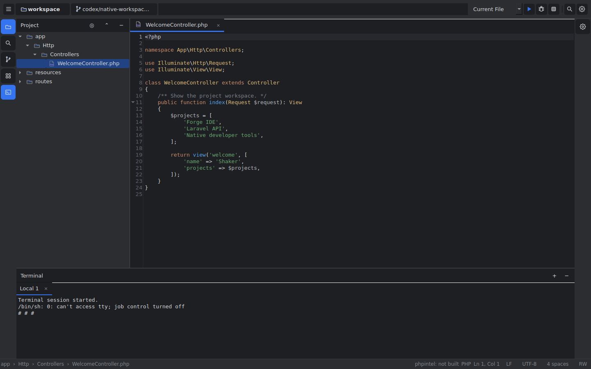

# Forge IDE

**A native PHP/Laravel desktop IDE — built for speed with Qt 6 and Rust.**

[](https://github.com/Shaker-Al-Muzaini/phpstormclon/actions)
[](LICENSE)

> **Status:** Milestone 1 — IDE shell in progress. The current build can browse a project and edit basic text files; PHP/Laravel intelligence and the full editor are not implemented yet. See [PROGRESS.md](PROGRESS.md).

The Terminal tool window currently runs basic commands in a redirected PowerShell session
from the open project directory (including commands such as `ls`). Full ConPTY emulation and
interactive terminal applications remain planned for M6.

---

## Overview

Forge IDE aims to deliver PhpStorm-level PHP and Laravel development capabilities in a
fully open, native Windows application. It is designed from the ground up for speed:

- **UI**: C++20 + Qt 6.8 LTS with Qt Widgets (not QML) — instant startup, fluid scrolling
- **Analysis**: Rust service `phpintel` — currently a JSON-RPC foundation with ping and
  lifecycle handling; parsing, semantic indexing, type inference, and completion are planned
- **Protocol**: JSON-RPC 2.0 over stdio (LSP 3.17-compatible) — the analyzer can be used
  from other editors too
- **Services**: Separate Rust processes for Git (`vcs`), Xdebug (`dbgp`), database
  (`dbtools`), terminal (`term`), and local AI (`ai-gateway`) — a crashing service never
  crashes the UI
- **Private & offline**: No telemetry, no cloud. Network access is limited to localhost
  and explicit user actions (Composer, Git remotes, plugin marketplace)

## Features (planned — see milestones)

| Milestone | Feature |
|-----------|---------|
| M0 | Foundation, CI, service supervisor, JSON-RPC |
| M1 | Shell, docking, themes, keymap, i18n |
| M2 | Editor widget, multi-caret, find/replace, project tree |
| M3 | PHP/Blade/HTML/CSS/JS parsing, syntax highlighting |
| M4 | Semantic index, go to definition, Search Everywhere |
| M5 | Completion, diagnostics, quick fixes, formatter |
| M6 | Terminal, run configurations, PHPUnit/Pest, Composer |
| M7 | Full Git integration with merge tool and log graph |
| **M8** | **Laravel plugin, plugin system — v0.1.0 release** |
| M9 | Refactoring suite |
| M10 | Xdebug debugger |
| M11 | Database tools |
| M12 | Local AI assistant (Ollama, llama.cpp) |
| M13 | Polish, performance, accessibility, i18n |

## Workspace redesign

The current feature branch adds a compact native IDE shell, a separate Shaker-branded startup splash, six themes, working file/action/project search, shared-document editor splits, external-write protection, and declarative extension installation through Open VSX or local VSIX/ZIP packages.

See [Windows build/run instructions](docs/WINDOWS.md), [verification and visual differences](docs/WORKSPACE_REDESIGN.md), and [current progress](PROGRESS.md). Language-engine, full debugger/Git/database/AI milestones remain incomplete. Executable VS Code and JetBrains plugins require their own extension hosts and are not supported by the declarative importer.



## Building

### Prerequisites

| Tool | Version | Where to get |
|------|---------|--------------|
| Qt 6.8 LTS | 6.8.x | [qt.io/download-open-source](https://www.qt.io/download-open-source) — pick MSVC 2022 64-bit |
| Rust | 1.99.1 (pinned in `rust-toolchain.toml`) | [rustup.rs](https://rustup.rs/) |
| CMake | 4.x | [cmake.org](https://cmake.org/download/) |
| Visual Studio 2022 | 17.x | C++ Desktop workload required |
| Ninja | any | `winget install Ninja-build.Ninja` |
| Git | any | [git-scm.com](https://git-scm.com/) |

### Quick Start (Windows)

```powershell
# 1. Install toolchain (if not already installed)
powershell -File tools\bootstrap.ps1

# 2. Open a Developer Command Prompt for VS 2022 (x64 Native Tools)
# Then:
$qtRoot = "C:\Qt\6.8.x\msvc2022_64"

# 3. Configure (set your Qt path)
cmake --preset windows-debug "-DCMAKE_PREFIX_PATH=$qtRoot"

# 4. Build
cmake --build build\windows-debug

# 5. Run the C++ tests and make Qt DLLs available to the application
$env:PATH = "$qtRoot\bin;$env:PATH"
ctest --preset windows-debug --output-on-failure

# 6. Run Rust tests
cargo test --all

# 7. Run the IDE (the phpintel service starts alongside it)
& .\build\windows-debug\bin\ForgeIDE.exe
```

### Build the Rust services only

```powershell
cargo build --all
cargo test  --all
```

## Repository Layout

```
forge-ide/
├── CMakeLists.txt          Top-level CMake
├── Cargo.toml              Rust workspace
├── vcpkg.json              C++ dependency manifest
├── rust-toolchain.toml     Pinned Rust version
├── PROGRESS.md             What's done, what's next
├── app/                    Qt entry point + MainWindow
├── core/                   ServiceSupervisor, RpcClient, ActionManager, Settings
├── ui/                     Editor widget, gutter, tree views, popups
├── platform/               OS abstraction (paths, processes, dialogs)
├── sdk/                    Public C ABI plugin SDK
├── services/
│   ├── rpc-common/         Shared JSON-RPC 2.0 framing types
│   ├── phpintel/           PHP analysis service (tree-sitter)
│   ├── vcs/                Git service (git2)
│   ├── dbgp/               Xdebug DBGp client
│   ├── dbtools/            Database tools (sqlx)
│   ├── term/               Terminal/PTY (portable-pty)
│   └── ai-gateway/         Local AI (Ollama/llama.cpp)
├── plugins/                First-party plugins (laravel, blade, pest, composer, docker)
├── resources/
│   ├── themes/             graphite.json, daylight.json
│   ├── keymaps/            default.json (PhpStorm-compatible), vscode.json
│   └── fonts/              JetBrains Mono, Inter (SIL OFL)
├── tests/                  C++ unit tests + integration tests + fixtures
├── tools/                  bootstrap.ps1, release scripts
└── docs/
    ├── ARCHITECTURE.md     Component diagrams
    ├── DECISIONS.md        All version and design decisions
    ├── PLUGIN_SDK.md       Plugin development guide
    └── KEYMAP.md           All key bindings reference
```

## License

Apache-2.0. See [LICENSE](LICENSE).

Third-party licenses: see [THIRD_PARTY_NOTICES.md](THIRD_PARTY_NOTICES.md) (generated in CI).

Preferred fonts: JetBrains Mono and Inter when installed locally; font files are not currently bundled.
Icons and startup artwork: original project QPainter glyphs; third-party icon sets remain planned.

## Contributing

See [CONTRIBUTING.md](CONTRIBUTING.md). All contributions are welcome.

## Name

"Forge IDE" is a working codename. The product name lives in `CMakeLists.txt` as
`FORGE_PRODUCT_NAME` and in `services/rpc-common/src/types.rs` as the service name.
The owner may rename it; a single find-replace suffices.
