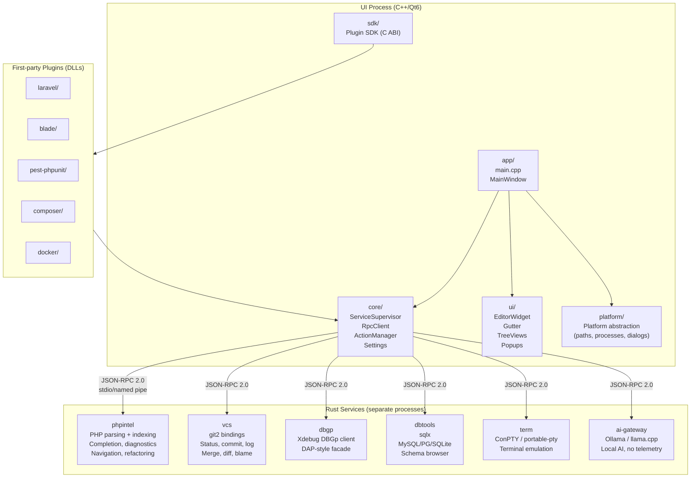
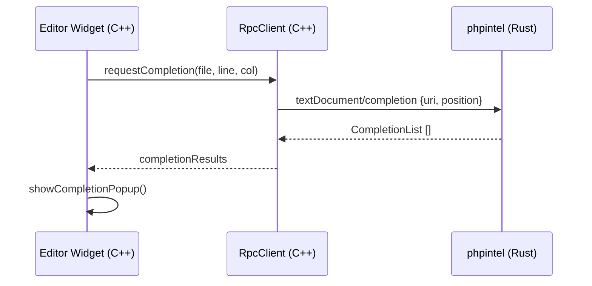

# Forge IDE — Architecture

## Component Overview



## Process Model

```
┌────────────────────────────────────────────────┐
│  ForgeIDE.exe (Qt6 / C++20)                            │
│                                                        │
│  ┌──────────────────────────────────────────┐         │
│  │  ServiceSupervisor                       │         │
│  │  - starts/stops/restarts services        │         │
│  │  - exponential back-off on crash          │         │
│  │  - status shown in status bar             │         │
│  └──────────────────────────────────────────┘         │
└────────────────────────────────────────────────┘
          |stdio/pipe|   |stdio/pipe|   ...
  ┌──────────┐   ┌─────────┐
  │phpintel  │   │vcs      │  ...
  │(Rust)    │   │(Rust)   │
  └──────────┘   └─────────┘
```

## RPC Protocol

All services communicate over JSON-RPC 2.0 using LSP 3.17 framing:

```
Content-Length: <n>\r\n
\r\n
<UTF-8 JSON body, n bytes>
```

Custom methods use the `forge/` namespace (e.g. `forge/index`, `forge/completions`).
Standard LSP methods are used where they exist (e.g. `textDocument/completion`).

## File Layout

See [Section 4 of the master spec](../README.md#repository-layout).

## Data Flow: Completion Request



## Plugin Architecture

```mermaid
graph LR
    subgraph Core
        EP[ExtensionPointRegistry]
        IC[IdeContext]
    end
    subgraph Plugin DLL
        MF[plugin.json manifest]
        EP2[Extension registrations]
    end
    EP <--> EP2
    IC --> Plugin DLL
```

Plugins are native DLLs loaded via the stable C ABI in `sdk/`. They receive an
`IdeContext` giving access to the project model, editor, actions, settings, and
RPC. The plugin manifest declares permissions; unsigned plugins require user
confirmation.
